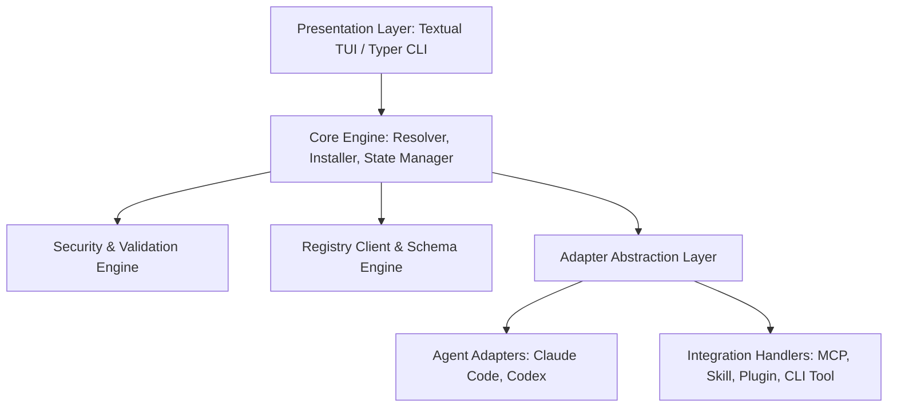
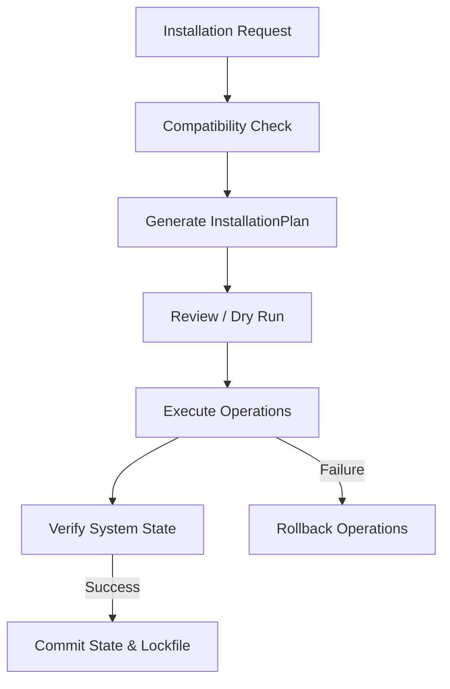
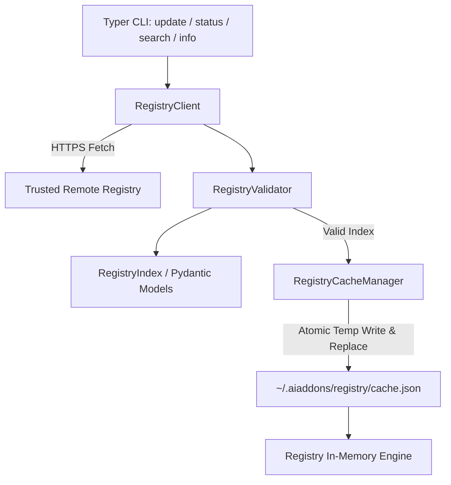

# Technical Architecture & Implementation Plan: AI Add-ons Manager (`aiaddons`)

## 1. Recommended Project Architecture

The application uses a **Hexagonal / Layered Architecture** with a Domain-Driven Core. This keeps core business logic (compatibility checking, dependency resolution engine, security verification, and transactional installation) decoupled from presentation interfaces (TUI & CLI) and third-party agent/file system implementations.



### Core Architecture Layers:
1. **Domain Models & Rules (`core/`)**: Pure Python representations of Integrations, Manifests, Agents, Local State, and Compatibility constraints.
2. **Registry & Security (`registry/`)**: Remote fetching, local caching, JSON schema verification, executable whitelisting, and cryptographic checksum validation.
3. **Target Adapters (`agents/`)**: Agent detection logic and config file managers for Claude Code and Codex.
4. **Integration Handlers (`integrations/`)**: Type-specific logic to process MCP configs, deploy Agent Skills, handle Plugins, or link CLI tools.
5. **Transactional Installation Engine (`installer/`)**: Reversible execution pipeline (`InstallPlan` with `RollbackStack`) ensuring atomic installs/uninstalls.
6. **Presentation Layer (`tui/`, `cli/`)**: Rich TUI interface (via Textual) and headless scripting interface (via Typer).

---

## 2. Folder Structure

We adopt the standard **`src/` layout** (PEP 621) with `hatchling` as the build backend.

```text
aiaddons/
├── pyproject.toml
├── README.md
├── LICENSE
├── docs/
│   └── ARCHITECTURE.md
├── tests/
│   ├── unit/
│   │   ├── test_compatibility.py
│   │   ├── test_security.py
│   │   ├── test_mcp_handler.py
│   │   └── test_claude_adapter.py
│   ├── integration/
│   │   └── test_installer_pipeline.py
│   └── fixtures/
│       └── sample_registry.json
└── src/
    └── aiaddons/
        ├── __init__.py
        ├── __main__.py
        ├── cli/                   # Typer CLI Entrypoints
        │   ├── main.py
        │   └── commands/          # list, install, remove, update, doctor, search
        ├── tui/                   # Textual Interactive Terminal UI
        │   ├── app.py
        │   ├── screens/           # BrowserScreen, DetailScreen, HealthScreen
        │   └── widgets/           # IntegrationCard, AgentSelector, SearchBar, StatusFooter
        ├── core/                  # Domain Models & Business Logic
        │   ├── models/            # Pydantic Schemas (Integration, Agent, State)
        │   ├── resolver.py        # SemVer & Compatibility Resolver
        │   └── installer.py       # Transactional Installation Pipeline
        ├── agents/                # Agent Detection & Adapter Implementations
        │   ├── base.py            # BaseAgentAdapter protocol
        │   ├── claude_code.py     # Claude Code Detector & Config Manager
        │   └── codex.py           # OpenAI Codex Detector & Config Manager
        ├── integrations/          # Integration Handlers
        │   ├── base.py            # BaseIntegrationHandler protocol
        │   ├── mcp.py             # MCP Server Config Handler
        │   ├── skill.py           # Agent Skill File Deployer
        │   ├── plugin.py          # Composite Plugin/Add-on Handler
        │   └── cli_tool.py        # External CLI Tool Dependency Linker
        ├── registry/              # Registry & Validation Engine
        │   ├── client.py          # HTTP Registry Fetcher with Cache
        │   ├── schema.py          # Pydantic & JSON Schema Validator
        │   └── security.py        # Command Sanitizer, Whitelist & Checksum Engine
        └── state/                 # Local State & Lockfile Management
            ├── store.py           # Installed State Store (~/.aiaddons/state.json)
            └── lockfile.py        # Workspace Lockfile Handler (aiaddons.lock)
```

---

## 3. Python Technology Stack

- **Python Version**: Python 3.11+ (modern async, improved performance, native typing).
- **TUI Framework**: [`Textual`](https://textual.textualize.io/) (modern async TUI framework built on Rich; supports full keyboard/mouse control, CSS-like styling, reactive UI widgets, and checkbox lists).
- **CLI Framework**: [`Typer`](https://typer.tiangolo.com/) + [`Rich`](https://rich.readthedocs.io/) (for headless command execution and formatted terminal output).
- **Data Validation & Modeling**: [`Pydantic v2`](https://docs.pydantic.dev/) (fast Rust-backed validation and strict typing for registry schemas and configs).
- **HTTP Client**: [`httpx`](https://www.python-httpx.org/) (async HTTP client with connection pooling, retries, and timeout controls).
- **Version & SemVer Management**: [`packaging`](https://packaging.pypa.io/) (standard library for parsing agent/Python version specifiers).
- **Build Backend**: `hatchling` (PEP 517 standard build system).

---

## 4. Agent Abstraction for Claude Code and Codex

All target AI agents implement a common abstract interface:

```python
class BaseAgentAdapter(Protocol):
    id: str  # e.g., "claude-code", "codex"
    name: str  # e.g., "Claude Code", "OpenAI Codex"

    def detect(self) -> AgentDetectionResult: ...
    def get_config_path(self, scope: Scope) -> Path: ...
    def supports_integration(self, integration_type: IntegrationType) -> bool: ...
    def install_mcp(self, spec: MCPSpec, scope: Scope) -> None: ...
    def install_skill(self, skill_dir: Path, scope: Scope) -> None: ...
    def remove_integration(self, integration_id: str, scope: Scope) -> None: ...
```

### Claude Code Adapter (`ClaudeCodeAdapter`):
- **Detection**: Checks for `claude` executable in `PATH` and existence of `~/.claude.json` or `.claude/`.
- **MCP Config**: Reads/writes `mcpServers` object in `~/.claude.json` (Global) or project `.claude.json` (Workspace).
- **Skill Path**: Installs skills to `~/.claude/skills/` (Global) or `.claude/skills/` (Workspace).

### Codex Adapter (`CodexAdapter`):
- **Detection**: Checks for `codex` binary in `PATH` and existence of `~/.codex/` directory.
- **MCP Config**: Reads/writes `mcpServers` in `~/.codex/config.json` or equivalent agent configuration file.
- **Skill Path**: Installs skills to `~/.agents/skills/` (Workspace) or global agent directory.

---

## 5. Registry Architecture

The registry is **declarative and metadata-driven**:

1. **Remote Index**: A static JSON manifest hosted on a CDN or GitHub Pages (`https://registry.aiaddons.dev/index.json`).
2. **Local Caching**: Registry indexes are cached locally (`~/.cache/aiaddons/registry.json`) with configurable TTL (e.g., 24 hours) and force refresh support (`aiaddons registry refresh` / `--refresh` flag).
3. **Custom Registry Support**: Users can add private or internal company registries via `aiaddons registry add <url_or_path>`.
4. **Lazy Loading**: The primary index contains essential metadata (ID, name, category, summary, compatibility). Complete handler specifications are fetched on demand when inspecting or installing.

---

## 6. Registry Schema

Every integration is validated against a strict Pydantic model (`IntegrationManifest`) with `extra = "forbid"` configuration:

```yaml
id: github-mcp
name: GitHub MCP Server
version: 1.2.0
description: Model Context Protocol server for searching code, managing PRs, and inspecting issues.
documentation_url: https://github.com/modelcontextprotocol/servers
license: MIT
category: developer-tools
integration_type: mcp
target_agents:
  - claude-code
  - codex
supported_scopes:
  - global
  - workspace
source:
  source_type: package
  package_name: "@modelcontextprotocol/server-github"
  checksum: "sha256:e3b0c44298fc1c149afbf4c8996fb92427ae41e4649b934ca495991b7852b855"
dependencies:
  - name: npx
    type: cli
    required: true
trust:
  verification_status: verified
  publisher:
    name: Model Context Protocol Team
    url: https://github.com/modelcontextprotocol
    declared_verified: true
  allowed_executables:
    - npx
tags:
  - github
  - mcp
  - git
handler_spec:
  mcp:
    transport: stdio
    runtime: npx
    package_name: "@modelcontextprotocol/server-github"
    env_vars:
      - name: GITHUB_PERSONAL_ACCESS_TOKEN
        required: true
        secret: true
        description: GitHub PAT with repo access
```

---

## 7. MCP Integration Architecture

- **Handler**: `MCPIntegrationHandler`.
- **Behavior**: Instead of executing MCP servers directly, `aiaddons` acts as a configuration builder.
- **Workflow**:
  1. Parses the MCP handler spec from the registry.
  2. Prompts the user (via secure TUI modal or CLI prompt) for required environment variables (e.g., API keys).
  3. Formats and safely injects the server definition into the target agent's config file (e.g., `~/.claude.json` under `mcpServers`).
  4. Manages cleanup by removing the entry on uninstallation.

---

## 8. Skills Integration Architecture

- **Handler**: `SkillIntegrationHandler`.
- **Behavior**: Downloads or extracts an Agent Skill bundle (containing `SKILL.md` and optional supporting assets).
- **Workflow**:
  1. Validates the `SKILL.md` frontmatter and metadata.
  2. Verifies that the skill structure complies with target agent specifications.
  3. Deploys the skill files into the agent's designated skill directory (`~/.claude/skills/<skill-id>` or `.agents/skills/<skill-id>`).
  4. Tracks deployed files in local state for clean removal.

---

## 9. Plugin/Add-on Architecture

- **Handler**: `PluginIntegrationHandler`.
- **Behavior**: Handles composite packages that include a combination of MCP servers, skills, and CLI dependencies.
- **Workflow**:
  1. Breaks the plugin into sub-component installation tasks.
  2. Executes child tasks within a single composite transaction.
  3. Ensures all sub-components are active or rolls back the entire installation if any component fails.

### Distinction: Composite Plugin Abstraction vs Native Agent Capability
- **`IntegrationType.PLUGIN`**: An `aiaddons` composite packaging abstraction combining multiple child integrations (MCP servers, agent skills, CLI dependencies).
- **`AgentCapability.PLUGIN`**: A native agent capability indicator for agents that explicitly support direct native plugin systems.

The `CompatibilityEngine` does NOT conflate these two concepts: `IntegrationType.PLUGIN` does not require `AgentCapability.PLUGIN` from target agents (such as Claude Code or Codex). Instead, composite plugin compatibility is evaluated through the compatibility of its underlying child components.

---

## 10. Installation Engine Architecture (Phase 5A)

The installation engine uses a **Declarative & Transactional Plan Execution** architecture. The core principle is that the registry describes **WHAT** an integration is, while trusted application code determines **HOW** it is installed. Metadata never directly executes commands.



### 10.1 Installation Pipeline
1. **Request Ingestion**: Takes `IntegrationManifest`, `AgentDetectionResult`, and requested `Scope`.
2. **Compatibility Evaluation**: `CompatibilityEngine` verifies target agent support, scope support, capabilities, and dependencies.
3. **Plan Generation**: Type-specific installer (`MCPInstaller`, `SkillInstaller`, `PluginInstaller`, `CLIToolInstaller`) constructs an `InstallationPlan`.
4. **Safety & Path Traversal Verification**: `plan.validate_safety()` enforces strict operation-level path validation, target root boundaries, MCP package sanitization, environment variable restrictions, configuration scope protection, and rollback metadata safety.
5. **Dry Run / Review**: `aiaddons install <addon-id> --dry-run` displays planned changes without mutating filesystem or agent configurations.
6. **Transactional Execution (Phase 5B)**: Atomic step execution with rollback tracking.

### 10.2 Installation Plan Model (`InstallationPlan`)
The `InstallationPlan` model is an immutable representation of planned operations:
- `addon_id`, `addon_name`, `addon_version`: Identifies the target add-on.
- `target_agent`, `target_agent_name`: Target AI coding agent (e.g. `claude-code`, `codex`).
- `target_scope`: `global` or `workspace`.
- `integration_type`: `mcp`, `skill`, `plugin`, or `cli_tool`.
- `source`: Source specification metadata (`SourceSpec`).
- `planned_operations`: List of declarative, typed operation models (`BaseOperation`).
- `dependencies`: Evaluated dependency check results.
- `warnings`: Operational or trust warnings.
- `risk_level`: Severity rating (`LOW`, `MEDIUM`, `HIGH`).
- `reversible`: Boolean indicating if all planned operations support rollback.
- `rollback_info`: `RollbackMetadata` containing explicit inverse operations.

### 10.3 Declarative Operation Model & Security Guarantees
Operations represent high-level structural intent rather than arbitrary shell execution. Generic command operations (e.g., `ExecuteCommand`, `ShellCommand`, `RunScript`) are strictly forbidden.

#### Security Guarantees:
- **Mandatory Target Root & Boundary Confinement**: Every operation requires an explicit `target_root`. Future execution engines MUST canonicalize paths (`resolved_root = Path(target_root).resolve()`, `resolved_dest = (resolved_root / destination).resolve()`) and reject any operation if `resolved_dest` is outside `resolved_root`.
- **Operation-Level Path Validation**: All operation path fields (`directory_path`, `destination_path`, `file_path`, `config_path`, `destination_dir`) reject `..` traversal sequences, POSIX absolute paths, Windows drive letters, UNC network paths, URL-encoded traversal, and null bytes.
- **Typed Execution Payloads**: Operations contain complete execution payloads (`content: str` in `WriteFileOperation`, `value: Any` in `ModifyJsonOperation`/`ModifyYamlOperation`) rather than summaries alone.
- **MCP Package Sanitization**: `AddMcpServerOperation.package_name` enforces strict package-name regex formatting, prohibiting argument-injection vectors (leading `-`), whitespace, shell metacharacters, or path separators.
- **Environment Variable Restrictions**: `env_var_names` enforces valid identifier syntax (`[A-Za-z_][A-Za-z0-9_]*`) and blocks dangerous process manipulation variables (`LD_PRELOAD`, `PYTHONPATH`, `NODE_OPTIONS`, `PATH`, etc.).
- **Configuration Scope Protection**: `ModifyJsonOperation` and `ModifyYamlOperation` block modifications to sensitive root agent configuration keys (`permissions`, `allow_all`, `security`, `telemetry`, `auto_approve`, `hooks`, `trust`).
- **Comprehensive Rollback Safety**: `InstallationPlan.validate_safety()` validates both `planned_operations` AND `rollback_info.rollback_operations` for path traversal and shell safety.

Supported typed operations:
- **`CreateDirectoryOperation`**: Ensures target skill or plugin directories exist within `target_root`.
- **`CopyFileOperation`**: Copies asset bundles safely.
- **`WriteFileOperation`**: Writes structured configuration or skill definitions containing explicit `content`.
- **`ModifyJsonOperation`**: Safely updates JSON configuration files (e.g. `mcpServers` in `~/.claude.json`) with strongly typed `value` payloads.
- **`ModifyYamlOperation`**: Safely updates YAML configurations with strongly typed `value` payloads.
- **`AddMcpServerOperation`**: Registers MCP server parameters (`runtime`, `package_name`, `transport`, `env_var_names`).
- **`AddSkillOperation`**: Deploys skill markdown instructions (`SKILL.md`) and supporting files.
- **`AddPluginReferenceOperation`**: Registers composite plugin component references.

### 10.4 Transaction Model & Rollback Strategy
Each installation is represented by an `InstallationTransaction` tracking transaction state through phases:
`REQUESTED` → `COMPATIBILITY_CHECKED` → `PLANNED` → `REVIEWED` → `EXECUTING` → `VERIFIED` → `COMMITTED`.

If an error occurs during execution, the transaction transitions to `FAILED` and triggers `RollbackMetadata.rollback_operations` in reverse sequence to restore host system state. All rollback operations are validated against the same security guardrails as forward operations.

### 10.5 Dry-Run Architecture
The CLI supports `aiaddons install <addon-id> --dry-run`:
- Loads manifest metadata.
- Performs agent detection and compatibility evaluation.
- Generates the complete `InstallationPlan`.
- Displays formatted steps in terminal without modifying configuration, downloading packages, making network calls, or launching subprocesses.
- Running without `--dry-run` reports: `"Real installation is not implemented yet. Use --dry-run."`

### 10.6 Secure External Package Execution Architecture (Phase 5B.2)
The external package execution layer (`src/aiaddons/core/execution/external/`) provides a secure, trusted execution engine for package manager operations (`npx`, `uvx`, `pip`, `npm`, `git`, `python`, `node`) required by typed installation plans.

#### Architectural Principles:
1. **Registry Metadata vs Application Execution**: Registry metadata describes **WHAT** (e.g. package `@modelcontextprotocol/server-github`), while trusted application code determines **HOW** it is executed. Metadata never supplies raw command strings.
2. **Strict Executable Allowlist**: Only pre-approved runtime binaries (`npx`, `uvx`, `pip`, `npm`, `git`, `python`, `node`) are permitted. Resolves executable binaries dynamically via `shutil.which` and validates that the resolved binary matches the allowlist.
3. **No Shell Invocations (`shell=False`)**: Processes are executed strictly using argument vectors (`list[str]`) passed directly to `subprocess.Popen` with `shell=False`. Neither `cmd.exe /c`, `powershell -Command`, `bash -c`, nor `shell=True` are ever used.
4. **Windows Compatibility**: On Windows, `shutil.which` resolves native `.cmd` or `.exe` launchers (e.g. `npx.cmd`, `pip.exe`, `git.exe`) safely without launching intermediary shell wrappers.
5. **Argument & Package Sanitization**: Every argument in a command vector is validated to reject null bytes (`\0`), shell metacharacters (`;&||><$\``), inline code evaluation flags (`--eval`, `-e`, `-c`), path traversal, and command injection attempts. Package names are validated against strict regex rules.
6. **Environment Isolation & Secret Protection**: Custom environment variables are validated to prevent overriding restricted process manipulation variables (`LD_PRELOAD`, `PYTHONPATH`, `NODE_OPTIONS`, `PATH`, etc.). Secrets are automatically masked as `***MASKED***` in stdout, stderr, and log output.
7. **Timeout Enforcement**: Process execution enforces an explicit timeout (default 120 seconds). Processes exceeding timeout are forcibly terminated (`proc.kill()`) and raise `ProcessTimeoutError`.
8. **Dry-Run Integrity Guarantee**: Under `--dry-run`, `ExternalRunner.execute()` simulates execution and returns a dry-run result with zero subprocess invocations, zero network calls, and zero filesystem mutations.
9. **Transaction & Rollback Integration**: Integrated with `InstallationTransaction` state transitions (`REQUESTED` → `EXECUTING` → `VERIFIED` → `COMMITTED`, or `FAILED` → `ROLLED_BACK`). External package installations that cannot be undone automatically without host side-effects are represented explicitly as non-reversible steps.

### 10.7 Unified Transactional Pipeline & Phase 5B Consolidation
The Phase 5B.4–5B.7 consolidation unifies all agent configuration mutations, skill bundle deployments, transaction state tracking, and local state persistence into a single atomic execution pipeline:

1. **Unified Agent Adapter Pipeline**: All configuration mutations for Claude Code (`ClaudeCodeAdapter`) and OpenAI Codex (`CodexAdapter`) across Global (`~/.claude.json`, `~/.codex/`) and Workspace (`.claude.json`, `.codex/`) scopes execute via `InstallationEngine` → `InstallationPlan` → `ExecutionEngine` → `AgentAdapter` → Atomic file primitives. No adapter independently mutates filesystem state outside the transaction pipeline.
2. **Real Skill Bundle Deployment**: `SkillInstaller` and `ExecutionEngine` extract and deploy real skill bundles (`SKILL.md` and supporting files) directly from `manifest.source.path`. All file paths are strictly validated against target root boundaries (`verify_safe_target_path`), prohibiting path traversal, null bytes, and symlink escape vectors.
3. **Crash-Safe Write-Ahead Log (WAL)**: `TransactionWALManager` persists durable transaction logs at `~/.aiaddons/transactions/<tx_id>.json`. The WAL records atomic state transitions across:
   `REQUESTED` → `COMPATIBILITY_CHECKED` → `PLANNED` → `REVIEWED` → `EXECUTING` → `VERIFIED` → `COMMITTED` (or `FAILED` → `ROLLED_BACK`).
   Interrupted transactions left in `EXECUTING` state are automatically detected and safely rolled back via `TransactionWALManager.recover_interrupted_transaction()`.
4. **Atomic State & Lockfile Persistence**: Upon successful verification and transaction commit, `ExecutionEngine` updates the central installed state database (`InstalledStateStore` in `~/.aiaddons/state.json`) and the workspace lockfile (`LockfileManager` in `<workspace>/aiaddons.lock`) atomically using atomic tempfile replace operations (`_atomic_write_file`).
5. **Dry-Run Side-Effect Prevention**: Running under `--dry-run` guarantees zero mutations to agent configs, zero skill file copies, zero state database writes, zero lockfile entries, and zero transaction log writes.

### 10.8 Secure Secret Management — Phase 5B.8
The Phase 5B.8 secret management framework isolates, masks, and resolves environment secrets with strict security guarantees:

1. **Manifest Secret Declarations**: Add-on manifests declare environment variable requirements dynamically using `EnvVarSpec` (`name`, `secret: bool`, `required: bool`, `description`). Manifests specify *that* a secret is required, but **NEVER** contain actual secret values or plaintext secret fields (`secret_value`, `token`, `password`, `api_key_value`).
2. **Secret Resolution Layer (`src/aiaddons/core/secrets/`)**: `SecretResolver` handles secret lookup against process environment variables (`os.environ`) and secure interactive prompts (`InputProvider` using `getpass` for hidden, no-echo terminal input). Optional secrets (`required: False`) are resolved as `OPTIONAL_MISSING` without prompting or errors. Missing required secrets in non-interactive environments raise `SecretResolutionError`. Arbitrary disk scanning (`.env`, shell history, browser data, credential databases) is strictly prohibited.
3. **In-Memory Secret Lifecycle**: Resolved secret values exist **ONLY in memory** (`ResolvedSecret.value` with `Field(exclude=True, repr=False)`) for the minimal duration required for process execution and are discarded immediately afterward.
4. **Environment Isolation**: External processes executed via `ExternalRunner` receive only the environment variables declared in `op.env_var_names` for that specific operation. Secrets belonging to one add-on are never leaked to unrelated add-ons. Manifests are prohibited from requesting or overriding restricted dangerous environment variables (`LD_PRELOAD`, `PYTHONPATH`, `NODE_OPTIONS`, `PATH`, `HOME`, `USERPROFILE`, `SUDO_USER`, etc.).
5. **Output & Exception Masking**: All resolved secret values are registered with `mask_secrets_in_text()`. Any occurrence of a secret value in `stdout`, `stderr`, exception tracebacks, `ExecutionResult`, `OperationExecutionResult`, or CLI logs is replaced with `***MASKED***` before display or logging.
6. **Strict Persistence Prohibition**: Real secret values are **NEVER** persisted to disk, transaction WAL logs (`InstallationTransaction`), installed state (`state.json`), workspace lockfiles (`aiaddons.lock`), or agent configuration files (which store template variables like `"${GITHUB_TOKEN}"`).
7. **Dry-Run Security Guarantees**: Under `--dry-run`, `SecretResolver` avoids prompting for secrets, executes zero subprocesses, modifies zero files/WAL/lockfiles, and exposes zero secret values, rendering plan representations safe for terminal display (e.g., `<secret required>`, `<secret configured>`).

### 10.9 Installation Verification — Phase 5B.9
Phase 5B.9 introduces a dedicated post-installation verification subsystem (`src/aiaddons/core/verification/`) that validates whether an installation actually produced the expected host state before committing transaction records:

> An installation is not considered committed until post-install verification succeeds.

1. **Verification Architecture**:
   ```text
   InstallationPlan → ExecutionEngine → Installation → VerificationEngine → VerificationResult → Transaction (COMMITTED or ROLLED_BACK)
   ```
   `VerificationEngine` acts as an independent observer. It does not blindly trust claimed publisher verification, `InstallationPlan`, or previous installed state; it directly inspects the host filesystem and configuration state.

2. **Verification Domain Models**:
   - `VerificationStatus`: Enum representing status (`PENDING`, `PASSED`, `FAILED`, `SKIPPED`).
   - `VerificationCheck`: Granular check result with `check_id`, `description`, `status`, `expected_value`, `actual_value`, `warning_info`, `error_info`. Configured with `extra="forbid"`. Secrets are strictly masked and never stored in `expected_value` or `actual_value`.
   - `VerificationResult`: Aggregate decision containing `addon_id`, `addon_name`, `target_agent`, `target_scope`, `status`, `verified: bool`, `checks`, `warnings`, `errors`, and ISO `timestamp`.

3. **Integration-Specific Verification Handlers**:
   - **MCP Verification (`AddMcpServerOperation`)**: Safely resolves and parses agent configuration JSON/YAML via `verify_path_security`. Verifies entry presence in `mcpServers`, runtime command (`npx`, `uvx`, `node`, `python`), package identity in `args`, transport settings, and environment variable name references (`"${VAR_NAME}"`). Detects malformed configuration safely while preserving unrelated MCP servers and top-level configuration.
   - **Skill Verification (`AddSkillOperation`)**: Validates skill directory existence, required `SKILL.md` presence, supporting file presence, and SHA-256 content hashes without dumping full skill contents into logs. Enforces path containment to prevent symlinks from escaping the destination directory.
   - **Plugin Verification (`AddPluginReferenceOperation`)**: Inspects composite plugin descriptors (`plugin.json`), verifying plugin reference registration, presence of all declared component IDs, and component resolution consistency without duplicating entries.
   - **Structural Operation Verification**: Re-checks existence and integrity of directories (`CreateDirectoryOperation`), file content SHA-256 hashes (`WriteFileOperation`, `CopyFileOperation`), and key-value path matches (`ModifyJsonOperation`, `ModifyYamlOperation`).

4. **Path & Symlink Security (TOCTOU Protection)**:
   All paths re-evaluate boundaries at verification time using `verify_path_security()`. Re-checks `resolved_dest.is_relative_to(resolved_root)` and verifies that symlink targets do not escape the target root directory, protecting against `..`, absolute path overrides, UNC paths, URL-encoded traversal, and null byte injections.

5. **Transaction Lifecycle Integration & Atomic Commit Timing**:
   Verification is fully integrated into `ExecutionEngine.execute_plan()`:
   - Successful verification transitions the transaction phase to `VERIFIED`.
   - Only AFTER verification succeeds are records persisted to `InstalledStateStore` (`~/.aiaddons/state.json`) and `LockfileManager` (`aiaddons.lock`).
   - Transaction phase then transitions to `COMMITTED`.
   - If verification fails, `ExecutionEngine` records safe failure errors (with secret values masked), skips state store and lockfile persistence, invokes the `RollbackStack`, performs post-rollback inspection (`verify_rollback`), and transitions the transaction phase to `ROLLED_BACK`.

6. **Rollback Verification**:
   `verify_rollback()` performs safe, read-only inspection after a rollback to confirm that newly created files/directories were removed and modified configuration keys were restored without executing any unsafe disk deletions.

7. **Dry-Run Guarantees**:
   Under `dry_run=True`, `VerificationEngine` executes structural plan inspection (`PLAN ONLY`), returns `VerificationResult` with check status `SKIPPED`, and performs zero subprocess executions, zero network requests, zero file mutations, zero state/lockfile persistence, and zero WAL writes.

### 10.10 CLI & TUI Installation Pipeline Integration — Phase 5B.10
Phase 5B.10 completes the user-facing interface layer, wrapping the foundational core engines (`CompatibilityEngine`, `InstallationEngine`, `ExecutionEngine`, `VerificationEngine`, `SecretResolver`, `TransactionWALManager`, `InstalledStateStore`, and `LockfileManager`) into safe, deterministic CLI commands and an interactive Textual TUI.

1. **User Interface Architecture**:
   ```text
   CLI / TUI Presentation Layer (Typer / Textual)
             ↓
   Application / Engine Layer
             ↓
   CompatibilityEngine → InstallationEngine → SecretResolver → ExecutionEngine → VerificationEngine
             ↓
   Transaction WAL + InstalledStateStore + LockfileManager
   ```
   The UI layer strictly delegates all business logic, path verification, subprocess executions, state mutations, and transaction updates to the core application engines. The UI layer does NOT modify files directly, execute shell binaries directly, or bypass security guarantees.

2. **CLI Installation Flow (`aiaddons install <addon-id>`)**:
   - **Manifest Resolution**: Queries the loaded `Registry` for `<addon-id>`. Returns exit code `1` (`ExitCode.INVALID_INPUT`) if not found.
   - **Agent Detection**: Scans system via `AgentDetectionManager`. Filters target agents matching manifest target spec or explicitly requested `--agent`.
   - **Compatibility Check**: Evaluates compatibility via `CompatibilityEngine`. Exits with exit code `3` (`ExitCode.COMPATIBILITY_FAILURE`) if incompatible.
   - **Installation Plan**: Generates dry-run `InstallationPlan` via `InstallationEngine`. Validates operation safety and path containment.
   - **Plan Preview & Confirmation**: Displays formatted operations plan. Prompts `Continue? [y/N]` (default `N`). Accepts non-interactive `--yes` / `-y` flag without bypassing compatibility or security checks.
   - **Secret Resolution**: Uses `SecretResolver` to inspect declared environment variable requirements (`env_vars`). Prompts required missing secrets interactively using hidden TTY input (`getpass`). In non-interactive mode, exits with exit code `5` (`ExitCode.EXECUTION_FAILURE`) if a required secret is missing. Masks secret values across stdout, Rich output, error messages, and JSON objects.
   - **Execution & Verification**: Executes plan via `ExecutionEngine`, which invokes `VerificationEngine.verify_plan()`. Displays checkmark results (`✓`). If verification fails, `ExecutionEngine` rolls back changes, displays rollback summary, and exits with exit code `6` (`ExitCode.VERIFICATION_FAILURE`).
   - **Transaction State Transitions**: Transaction phase transitions through `REQUESTED` → `COMPATIBILITY_CHECKED` → `PLANNED` → `REVIEWED` → `EXECUTING` → `VERIFIED` → `COMMITTED` (or `FAILED` / `ROLLED_BACK` on error).

3. **Side-Effect Free `--dry-run`**:
   Invoking `aiaddons install <addon-id> --dry-run` produces an installation plan preview, avoids executing subprocesses/network calls/file modifications/WAL writes/lockfile mutations/secret prompts, and explicitly outputs `"No changes were made."`.

4. **Structured JSON Output (`--json`)**:
   Deterministic, machine-readable JSON representation suitable for scripting. Output is rendered directly without terminal soft-wrapping escape characters. Excludes raw secret values, environment dumps, internal tracebacks, or raw shell command lines.

5. **Textual TUI Application (`aiaddons tui`)**:
   Interactive Textual interface (`AIAddonsTUIApp`) featuring add-on list navigation, target agent/scope selection, live compatibility evaluation, dry-run plan preview, hidden password secret input fields, execution logging, and transaction status reporting. Calls core engine services directly without duplicating business logic.

6. **Standardized Exit Codes (`ExitCode`)**:
   - `0`: Success (`ExitCode.SUCCESS`)
   - `1`: Invalid user/request input (`ExitCode.INVALID_INPUT`)
   - `3`: Compatibility failure (`ExitCode.COMPATIBILITY_FAILURE`)
   - `4`: Security validation failure (`ExitCode.SECURITY_FAILURE`)
   - `5`: Installation or execution failure (`ExitCode.EXECUTION_FAILURE`)
   - `6`: Verification or rollback failure (`ExitCode.VERIFICATION_FAILURE`)

---


## 11. Compatibility System

The `CompatibilityResolver` evaluates constraints before any action is taken:

1. **Agent Version Check**: Parses agent binaries and compares versions against requirements using `packaging.specifiers.SpecifierSet`.
2. **OS & Arch Check**: Verifies `sys.platform` against target manifest constraints.
3. **Dependency Runtime Check**: Verifies existence of required binaries on the host system (`npx`, `uvx`, `python`, `git`, `node`) using `shutil.which`.
4. **Conflict Resolution**: Detects naming collisions or conflicting MCP server configurations.

If any check fails, the TUI displays an explicit "Incompatible" badge detailing missing prerequisites.

---

## 12. Local State Management

- **Central Installed State**: Maintained at `~/.aiaddons/installed_state.json` (Windows: `%APPDATA%/aiaddons/installed_state.json`).
- **State Schema**: Tracks installed integration ID, version, target agent, installation scope, timestamp, installed files, and configured MCP keys.
- **Workspace Lockfile (`aiaddons.lock`)**: Created in project roots when workspace scope is used. Allows teams to check in `aiaddons.lock` so developers can run `aiaddons sync` to mirror identical integrations.

---

## 13. Security Model & Architecture Boundaries

Security is fundamental to `aiaddons`. The application prevents arbitrary command execution from remote registry manifests using strict architecture boundaries:

1. **No Generic Command Operations**: The operation model does not support `ExecuteCommand`, `ShellCommand`, or `RunScript`. All operations are strictly typed domain models.
2. **No `shell=True` Executions**: Any future subprocess invocations use strict argument vectors (`subprocess.run(["npx", "-y", ...])`), preventing shell injection attacks.
3. **Strict Binary Whitelist**: Only pre-approved runtime binaries (`npx`, `uvx`, `python`, `node`, `pip`, `git`) listed in `allowed_executables` are allowed. Unapproved executables are rejected.
4. **No Shell Metacharacters**: String fields in manifests and operations are scanned against `FORBIDDEN_SHELL_PATTERNS` (`;&||><$\``). Any match raises `SecurityValidationError`.
5. **Path Traversal Protection**: All relative paths are validated against `validate_safe_relative_path` to prevent path traversal outside designated target root directories.
6. **Dry-Run Isolation**: Dry-run plan generation makes no network calls, modifies no configuration files, and executes no subprocesses.
7. **Cryptographic Integrity**: Downloads (zip bundles, release archives) are validated against SHA-256 checksums published in the signed registry index.
8. **Secret Protection**: Sensitive environment keys (e.g., API tokens) are flagged as `secret: true`, masked in logs/UI, and stored securely.

---

## 14. CLI & TUI Design

### TUI Design (`aiaddons`):
Built with **Textual**:
- **Sidebar**: Agent selector (All, Claude Code, Codex), Category filter (DevTools, Database, Web, Workflow), Install Status filter (All, Installed, Updates).
- **Main View**: Interactive table/list of integrations with checkboxes for batch operations.
- **Detail Panel**: Description, publisher verification badge, required permissions, and compatibility details.
- **Status & Action Footer**: Keyboard shortcuts (`[Space]` Select, `[I]` Install, `[R]` Remove, `[U]` Update, `[D]` Health Check, `[/]` Search, `[Q]` Quit).

```text
┌────────────────────────────────────────────────────────────────────────────────────────────────────────┐
│ AI Add-ons Manager v0.2.0                                                     [Agent: Claude Code  ▼] │
├─────────────────┬──────────────────────────────────────────────────────────────────────────────────────┤
│ CATEGORIES      │ [ ] INTEGRATION              TYPE      CATEGORY       COMPATIBILITY   STATUS         │
│ ► All           │ ─── ──────────────────────── ───────── ────────────── ─────────────── ────────────── │
│   DevTools      │ [x] github-mcp-server        MCP       DevTools       ✓ Compatible    [Installed]    │
│   Database      │ [x] postgres-mcp             MCP       Database       ✓ Compatible    [Update Avail] │
│   Web           │ [ ] brave-search-mcp         MCP       Web            ✓ Compatible    [Not Installed]│
│   Workflow      │ [ ] caveman        Skill     Workflow       ✓ Compatible    [Not Installed]│
├─────────────────┴──────────────────────────────────────────────────────────────────────────────────────┤
│ DETAIL: postgres-mcp (v1.1.0) by Model Context Protocol Team [Verified]                                │
│ Allows AI agent to query database schemas, inspect tables, and safely execute read-only queries.       │
├────────────────────────────────────────────────────────────────────────────────────────────────────────┤
│ [Space] Toggle  [I] Install (2)  [R] Remove  [U] Update  [D] Doctor  [/] Search  [Q] Quit              │
└────────────────────────────────────────────────────────────────────────────────────────────────────────┘
```

### Non-Interactive CLI Commands:
- `aiaddons list [--installed] [--agent <agent>]`
- `aiaddons search <query>`
- `aiaddons install <id> [--scope global|workspace]`
- `aiaddons remove <id>`
- `aiaddons update [--all]`
- `aiaddons doctor`
- `aiaddons registry [list|add|refresh]`

---

## 15. Testing Strategy

1. **Unit Tests (`pytest`)**:
   - Pydantic schema validation for registry manifests.
   - Compatibility solver (SemVer logic and OS matching).
   - Command security sanitizer and metacharacter rejector.
   - JSON config diff generator.
2. **Mock Adapters**:
   - System calls (`shutil.which`, `subprocess.run`) mocked using `pytest` fixtures.
   - Isolated file system testing using `tmp_path`.
3. **TUI Tests**:
   - Automated TUI behavior testing using `Textual`'s built-in `App.run_test()` pilot driver.
4. **Integration Tests**:
   - End-to-end dry-run testing of the installation pipeline against dummy agent config files in isolated temporary directories.

---

## 16. Development Phases

| Phase | Focus | Key Deliverables |
|-------|-------|------------------|
| **Phase 1** | Core Foundation & Data Models | `pyproject.toml`, directory structure, Pydantic schemas, Registry client, Security sanitizer, State store |
| **Phase 2** | Agent & Integration Adapters | `ClaudeCodeAdapter`, `CodexAdapter`, `MCPIntegrationHandler`, `SkillIntegrationHandler` |
| **Phase 3** | Transactional Installation Engine | `InstallPlan`, `RollbackStack`, `CompatibilityResolver` |
| **Phase 4** | Typer CLI Commands | Headless CLI commands (`install`, `list`, `remove`, `search`) |
| **Phase 5** | Textual TUI Interface | Interactive TUI app with filtering, multi-select checkboxes, search, and detail modal |
| **Phase 6** | Health Check & Polish | `aiaddons doctor`, test suite coverage, error handling, documentation |

---

## 17. V1 vs V2 Scope

### V1 Scope (In-Scope):
- Supported Agents: **Claude Code** and **Codex**.
- Integration Types: **MCP**, **Skills**, **Plugins**, **CLI Tools**.
- Architecture: **Registry-driven** (JSON metadata schema, non-hardcoded logic).
- UI: Interactive **Textual TUI** + headless **Typer CLI**.
- Security: Command sanitization, executable whitelist, SHA-256 verification.
- Transactional Install/Uninstall/Update engine with rollback support.
- Local state management (`installed_state.json` & `aiaddons.lock`).
- `aiaddons doctor` health check command.

### V2 Scope (Future):
- Support for additional agents (Cursor, Windsurf, Gemini CLI, Aider).
- Remote registry publishing CLI workflow (`aiaddons publish`).
- Containerized/Sandboxed execution runner (Docker / Wasm for MCP servers).
- Dependency resolution graph between skills and plugins.

---

## Exact First Implementation Task Recommendation

Start with **Task 1: Core Foundation & Package Setup**:

1. Create `pyproject.toml` configuring `hatchling` as the build backend and declaring key dependencies (`typer`, `rich`, `textual`, `pydantic`, `httpx`, `packaging`).
2. Create the package directory structure inside `src/aiaddons/`.
3. Implement the core Pydantic domain schemas in `src/aiaddons/core/models/manifest.py` (`IntegrationManifest`, `AgentDetectionResult`, `RegistryIndex`).

---

## 18. Phase 6A — Registry Synchronization & Distribution Architecture

Phase 6A introduces a secure, metadata-driven registry synchronization layer allowing `aiaddons` to fetch, validate, cache, search, and inspect add-on manifests from trusted remote registries.

> **Fundamental Security Principle**:
> **Registry metadata describes WHAT.**
> **Trusted application code determines HOW.**

### 18.1 Key Architectural Components



1. **Registry Domain Index (`RegistryIndex`)**:
   Pydantic v2 model configured with `extra="forbid"`. Standardized schema versioning (`schema_version: "1.0"`), ISO generation timestamp (`generated_at`), and unique add-on manifest list (`manifests`). Rejects duplicate add-on IDs, unsupported schema versions, or unrecognised fields.

2. **Registry Validator (`RegistryValidator`)**:
   Dedicated validation layer executing deep manifest validation before accepting remote metadata:
   - Unique add-on ID verification across all index entries.
   - Source installability checks (`source.check_installable()`).
   - Cryptographic SHA-256 checksum format verification (`sha256:[a-fA-F0-9]{64}`).
   - Git commit SHA hex verification (`^[a-fA-F0-9]{40}$`).
   - Strict path traversal prevention (`validate_safe_relative_path`).
   - Package name sanitization (`validate_mcp_package_name`).
   - Environment variable identifier & restriction checks (`validate_env_var_name`).
   - Shell metacharacter rejection (`FORBIDDEN_SHELL_PATTERNS`).

3. **Trusted Remote Registry Client (`RegistryClient`)**:
   Fetches remote registry metadata using `httpx`.
   - **HTTPS Enforcement**: Rejects unencrypted `http://` URLs (allowing `localhost`/`127.0.0.1` strictly for local dev/testing).
   - **Timeout Controls**: Enforces explicit HTTP connection and read timeouts.
   - **Error Handling**: Converts HTTP 4xx/5xx, timeouts, network failures, and JSON syntax errors into typed `RegistryFetchError` exceptions.
   - **Zero Code Execution**: Downloads pure metadata; never evaluates scripts, executes subprocesses, or interprets strings as shell commands.

4. **Atomic Local Cache Manager (`RegistryCacheManager`)**:
   Manages local cache persistence at `~/.aiaddons/registry/cache.json`.
   - **Atomic File Updates**: Writes payload to a temporary file (`NamedTemporaryFile`), flushes and syncs (`os.fsync`), and replaces target atomically (`os.replace`).
   - **Corrupt Cache Protection**: A failed download or invalid schema validation aborts the update process and leaves the previous valid local cache untouched.
   - **Cache Status Reporting**: Provides `aiaddons registry status` metadata (cache path, schema version, last synced timestamp, add-on count, validity status, sync requirement).

5. **Local Offline Search & Inspection (`aiaddons search` & `aiaddons info`)**:
   - `aiaddons search <query>` performs keyword matching against ID, name, description, tags, category, publisher, and integration type using the local validated cache without issuing network requests.
   - `aiaddons info <addon-id>` displays detailed manifest metadata including security allowed executables, cryptographic source pins, dependencies, and child components for composite plugins.

6. **Composite Plugin Handling**:
   Integrations of type `plugin` retain child component references (`handler_spec.plugin.components`). `CompatibilityEngine` resolves child components dynamically without assuming `IntegrationType.PLUGIN == AgentCapability.PLUGIN`.

7. **Side-Effect Safety & Boundaries**:
   Registry synchronization (`aiaddons registry update`) writes **ONLY** to the local registry cache file (`~/.aiaddons/registry/cache.json`). It **NEVER**:
   - executes subprocesses or scripts
   - installs external packages
   - modifies agent configuration files (`~/.claude.json`, `~/.codex/`)
   - modifies installed state (`~/.aiaddons/state.json`)
   - modifies lockfiles (`aiaddons.lock`)
   - creates transaction WAL entries

---

## 19. Phase 6B — Secure Source Acquisition, Verification & Staging Architecture

Phase 6B introduces a secure, pluggable source acquisition and staging subsystem (`src/aiaddons/core/acquisition/`) that runs between Plan Generation and Execution in the transaction lifecycle.

```text
Registry Manifest → CompatibilityEngine → InstallationPlan → AcquisitionEngine → Staged Source → ExecutionEngine → VerificationEngine → Commit
```

### 18.1 Source Fetcher Implementations & Security
1. **`GitSourceFetcher` (`SourceType.GIT`)**:
   - Executes `git` commands via `ExternalRunner` (`shell=False`, allowlisted executable).
   - Enforces an immutable 40-character hexadecimal `commit_sha`. Rejects mutable branch or tag references without explicit cryptographic commit SHA pinning.
   - Disables git submodules (`--no-recurse-submodules`) and git hooks (`-c core.hooksPath=/dev/null`).
   - Verifies checked out `HEAD` commit SHA matches expected `commit_sha` via `git rev-parse HEAD`.
   - Never executes repository scripts or build commands.

2. **`UrlSourceFetcher` (`SourceType.URL`)**:
   - Enforces HTTPS for remote endpoints (allowing `localhost`/`127.0.0.1` strictly for local testing).
   - Streams downloads in 64KB chunks using `httpx`, computing SHA-256 checksums on the fly.
   - Compares computed SHA-256 digest against `SourceSpec.checksum`. Raises `ChecksumMismatchError` and deletes corrupted temp files on mismatch.
   - Enforces download size limits (100 MB default) and connection/read timeouts (30s).

3. **`SafeArchiveExtractor` (`extractor.py`)**:
   - Extractor for `.zip`, `.tar`, `.tar.gz`/`.tgz`, `.tar.xz` archives into isolated staging directories.
   - Pre-validates ALL entries before extracting any file.
   - Prevents ZipSlip / TarSlip path traversal (`validate_safe_relative_path` and `verify_safe_target_path`).
   - Rejects absolute paths, Windows drive letters (`C:`), UNC paths (`\\\\`, `//`), URL-encoded traversal (`%2e%2e`), null bytes (`\0`), symbolic/hard links pointing outside staging root, FIFO/device files, and setuid/setgid entries.
   - Zip Bomb Defense: Enforces resource limits on max file count (10,000 files), max uncompressed size (100 MB), and max compression ratio (100:1).

4. **`LocalSourceFetcher` (`SourceType.LOCAL`)**:
   - Validates local source path against path traversal and symlink escape rules.
   - Copies local files/directories safely into staging, or handles dot paths (`.`) without recursive repository duplication.

5. **`PackageSourceFetcher` (`SourceType.PACKAGE`)**:
   - Validates MCP package names (`validate_mcp_package_name`) to reject argument injection vectors.
   - Delegates URL package archives to `UrlSourceFetcher` with real streaming SHA-256 verification.
   - **Runtime Package Runner Specs (`package_name`)**: For packages executed directly via runtime runners (`npx`, `uvx`), `SourceSpec.checksum` records the upstream publish tarball SHA-256 hash for registry auditability and lockfile pinning. However, `aiaddons` does NOT download or verify the npm tarball at install time because execution is delegated to the host runtime (`npx -y <pkg>`). Real streaming SHA-256 checksum enforcement applies to direct archive downloads (`source_type: url`).

### 18.2 Staging Lifecycle (`SourceStagingManager`)
- Isolates transaction staging at `~/.aiaddons/staging/<transaction_id>/`.
- Applies restrictive permissions (`0700`) where supported.
- Cleans up staging directories automatically upon transaction commit or rollback, with Windows file-handle safety.

### 18.3 Transaction Lifecycle & Dry-Run Guarantees
- Introduces `TransactionPhase.SOURCE_ACQUISITION` in the WAL state pipeline.
- If source acquisition or checksum verification fails, the transaction transitions to `FAILED` → `ROLLED_BACK`, preventing execution of downstream operations.
- **`--dry-run` Guarantees**: Running with `--dry-run` performs ZERO network requests, ZERO `git` subprocess calls, ZERO archive extractions, ZERO disk writes, ZERO WAL entries, and ZERO secret prompts.

### 18.4 Limitations
- Phase 6B does NOT execute repository build scripts, `Makefile`s, or arbitrary package setup commands.
- Downloadable archives are restricted to `.zip`, `.tar`, `.tar.gz`/`.tgz`, `.tar.xz`.

---

## 20. Phase 6C — Staged Source Binding & Transaction Integrity Architecture

Phase 6C completes the end-to-end integration pipeline by binding the verified staged source output from `AcquisitionEngine` directly into `ExecutionEngine` operation execution, enforcing staging containment boundaries, ensuring explicit transaction lifecycle transitions, and maintaining atomic transaction rollback and staging cleanup.

### 20.1 End-to-End Pipeline Diagram

```
+------------------+     +-----------------------+     +-------------------+
| Registry Manifest| --> |  CompatibilityEngine  | --> |  InstallationPlan |
+------------------+     +-----------------------+     +-------------------+
                                                                 |
                                                                 v
+------------------+     +-----------------------+     +-------------------+
| Transaction WAL  | <-- |   AcquisitionEngine   | <-- |  Transaction Init |
| (WAL Persistence)|     | (Acquire & Stage Src) |     |  (Phase: PLANNED) |
+------------------+     +-----------------------+     +-------------------+
                                     |
                                     v
                         +-----------------------+
                         | Staged Source Binding |
                         | (staging_path / rel)  |
                         +-----------------------+
                                     |
                                     v
                         +-----------------------+
                         |    ExecutionEngine    |
                         |  (Staging Containment |
                         |   & Primitive Ops)    |
                         +-----------------------+
                                     |
                                     v
                         +-----------------------+
                         |   VerificationEngine  |
                         | (Post-Execution Ver)  |
                         +-----------------------+
                                     |
                                     v
+------------------+     +-----------------------+     +-------------------+
|  State & Lockfile| <-- |   Commit & Cleanup    | <-- | Transaction Phase |
|  (~/.aiaddons)   |     | (Staging Directory)   |     |   (COMMITTED)     |
+------------------+     +-----------------------+     +-------------------+
```

### 20.2 Key Staged Source Binding Rules
1. **Acquisition & Staging Binding**:
   During execution, `ExecutionEngine` invokes `AcquisitionEngine.acquire_source()` during `TransactionPhase.SOURCE_ACQUISITION`. The resulting `AcquiredSourceResult.staging_path` becomes the canonical root directory for all operation source references.

2. **Operation Subpath Resolution**:
   If `plan.source.path` specifies a relative path within the source archive/repo, `staged_addon_dir` resolves to `staging_path / validate_safe_relative_path(plan.source.path)` if that subdirectory exists, defaulting to `staging_path`.

3. **Staging Boundary Confinement**:
   Before executing `AddSkillOperation` or `CopyFileOperation`, `ExecutionEngine._dispatch_operation` resolves the source directory/file path and verifies that it is strictly contained within `acquired_result.staging_path` via `is_relative_to()`. If an operation attempts to reference a path outside the staged directory (e.g., path traversal or absolute symlinks), execution halts immediately and raises `SecurityValidationError`.

4. **Transaction State Machine Lifecycle**:
   Transactions traverse the exact state machine:
   `REQUESTED` → `COMPATIBILITY_CHECKED` → `PLANNED` → `SOURCE_ACQUISITION` → `EXECUTING` → `VERIFIED` → `COMMITTED` (or `FAILED` → `ROLLED_BACK`).

5. **Automatic Staging Cleanup**:
   Upon transaction completion (either `COMMITTED` or `ROLLED_BACK`), `ExecutionEngine` invokes `AcquisitionEngine.cleanup_staging(tx_id)` when `dry_run=False`, ensuring zero orphaned staging folders remain in `~/.aiaddons/staging/`.

6. **Dry-Run Zero Side-Effect Guarantee**:
   When `--dry-run` is active, `ExecutionEngine` and `AcquisitionEngine` bypass subprocess calls, network requests, disk mutations, state store writes, lockfile updates, and WAL log persistence.

7. **Secret Non-Persistence**:
   All error outputs and WAL logs filter sensitive environment variables and credentials using `mask_secrets_in_text`, ensuring secrets are never persisted or printed in plain text.

---

## 21. Phase 6 — Health Check & Polish Architecture (`aiaddons doctor`)

Phase 6 implements a comprehensive, read-only diagnostic system (`aiaddons doctor`) and health check engine (`src/aiaddons/core/health/`) designed to inspect, detect, and report inconsistencies, corruptions, runtime availability issues, and security violations across the host environment without modifying state or executing unallowlisted code.

```text
aiaddons doctor [--json] [--project-path <path>]
       │
       ▼
HealthCheckEngine (Read-Only)
       ├── check_registry()       -> Cache presence, JSON schema v1.0, freshness (<7d), secure HTTPS URL
       ├── check_installed_state()-> state.json syntax, schema, unique records, valid IDs/versions
       ├── check_lockfile()       -> aiaddons.lock syntax, schema, state consistency cross-checks
       ├── check_transactions()   -> WAL logs syntax, interrupted EXECUTING transactions
       ├── check_staging()        -> Orphaned staging directories, path name safety
       ├── check_runtimes()       -> python (required), git, node, npm, npx, pip, uvx (optional)
       ├── check_agents()         -> Claude Code & Codex detection, config syntax validity
       ├── check_consistency()    -> State vs Agent configs (MCP, Skills, Plugins existence)
       └── check_security()       -> Path traversal, dangerous env vars, runtime allowlist, secret leaks
       │
       ▼
HealthReport (PASS | WARN | FAIL)
       ├── Terminal Output: Categorized Rich format with symbols (✓/!, ✗, →) & remediation hints
       └── JSON Output: Structured JSON payload with strict secret masking & summary counts
```

### 21.1 Strict Read-Only & Zero-Mutation Invariant
The `aiaddons doctor` command and the underlying `HealthCheckEngine` are strictly non-mutating:
- **NEVER** installs, updates, or removes add-ons or packages.
- **NEVER** modifies agent configuration files (`~/.claude.json`, `~/.codex/`).
- **NEVER** writes or alters local state databases (`~/.aiaddons/state.json`).
- **NEVER** writes or alters workspace lockfiles (`aiaddons.lock`).
- **NEVER** alters or creates registry cache files (`~/.aiaddons/registry/cache.json`).
- **NEVER** creates, alters, or deletes transaction WAL logs (`~/.aiaddons/transactions/`).
- **NEVER** deletes or alters staging directories (`~/.aiaddons/staging/`).
- **NEVER** executes arbitrary downloaded scripts, binaries, or untrusted code.
- **NEVER** prompts for secrets, passwords, or API keys.

### 21.2 Diagnostic Categories & Checks

| Category | Check ID | Diagnostic Purpose | Failure / Warning Condition |
|----------|----------|-------------------|-----------------------------|
| **Registry** | `registry_url_secure` | Inspects registry endpoint protocol | Insecure HTTP remote registry URL |
| | `registry_cache_exists` | Checks local cache file presence | Cache missing (`aiaddons registry update` needed) |
| | `registry_cache_valid` | Validates JSON structure and schema | Corrupt/malformed cache file |
| | `registry_schema_version` | Validates supported index schema | Unsupported registry schema version != "1.0" |
| | `registry_cache_freshness`| Checks timestamp freshness | Cache older than 7 days |
| **Installed State** | `state_file_exists` | Checks `~/.aiaddons/state.json` | Database file missing (empty/clean state) |
| | `state_file_valid` | Validates JSON and model schema | Corrupted `state.json` syntax |
| | `state_records_valid` | Validates individual records | Invalid addon ID, SemVer, scope, or agent |
| **Lockfile** | `lockfile_exists` | Checks workspace `aiaddons.lock` | Lockfile not found in current project |
| | `lockfile_valid` | Validates YAML syntax & schema | Corrupt YAML lockfile |
| | `lockfile_state_consistency`| Cross-checks lockfile vs workspace state | Installed add-on missing from lockfile or vice versa |
| **Transactions** | `transactions_wal_valid` | Checks WAL log integrity | Malformed JSON in `~/.aiaddons/transactions/` |
| | `transactions_interrupted`| Checks for uncommitted transactions | Transactions stuck in `EXECUTING` or `SOURCE_ACQUISITION` |
| **Staging** | `staging_path_safety` | Inspects directory name boundaries | Staging folder with shell operators or path traversal |
| | `staging_orphaned` | Checks for stale staging folders | Staging folder from completed/rolled-back transaction |
| **Runtimes** | `runtime_python` | Validates Python interpreter (required) | Unavailable Python environment |
| | `runtime_<tool>` | Validates `git`, `node`, `npm`, `npx`, `pip`, `uvx` | Tool missing from system `PATH` |
| **AI Agents** | `agent_<agent_id>` | Detects Claude Code and OpenAI Codex | Agent missing or config JSON syntax error |
| | `agents_summary` | Aggregate detection overview | Zero AI coding agents detected |
| **Consistency** | `consistency_<id>_mcp` | Cross-checks MCP entry in agent config | Registered MCP missing in `.claude.json` / `.codex` |
| | `consistency_<id>_skill` | Cross-checks skill directory and `SKILL.md` | Registered skill files missing on disk |
| | `consistency_<id>_plugin`| Cross-checks plugin manifest and files | Registered plugin descriptor missing on disk |
| **Security** | `security_paths` | Boundary validation across state files | Path traversal (`..`), null bytes (`\0`), UNC paths |
| | `security_env_vars` | Restricted process injection checks | Dangerous env vars (`LD_PRELOAD`, `PYTHONPATH`, `PATH`) |
| | `security_executables` | Executable allowlist enforcement | MCP command using non-allowlisted binary |
| | `security_secrets` | Plaintext token & credential detection | Un-templated secret strings (`sk-...`, `ghp_...`) |

### 21.3 Standardized CLI Exit Codes
`aiaddons` CLI commands adopt standardized process exit codes across all subsystems:

| Exit Code | Constant | Meaning |
|-----------|----------|---------|
| `0` | `ExitCode.SUCCESS` | All health checks passed, or command completed successfully |
| `1` | `ExitCode.INVALID_INPUT` | Command-line arguments or syntax invalid |
| `2` | `ExitCode.WARNINGS_DETECTED` | Diagnostic warnings detected (e.g. stale cache, missing optional runtime) |
| `3` | `ExitCode.COMPATIBILITY_FAILURE` | Add-on compatibility resolution failed |
| `4` | `ExitCode.SECURITY_FAILURE` | Security check violation detected (unauthorized command / dangerous env var) |
| `5` | `ExitCode.EXECUTION_FAILURE` | Transaction execution or rollback failed |
| `6` | `ExitCode.VERIFICATION_FAILURE` | Post-installation verification checks failed |
| `7` | `ExitCode.HEALTH_CHECK_FAILURE` | Critical health check failure detected |
| `8` | `ExitCode.OPERATIONAL_ERROR` | Unexpected runtime error or operational crash |


